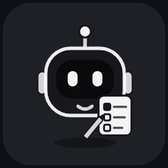
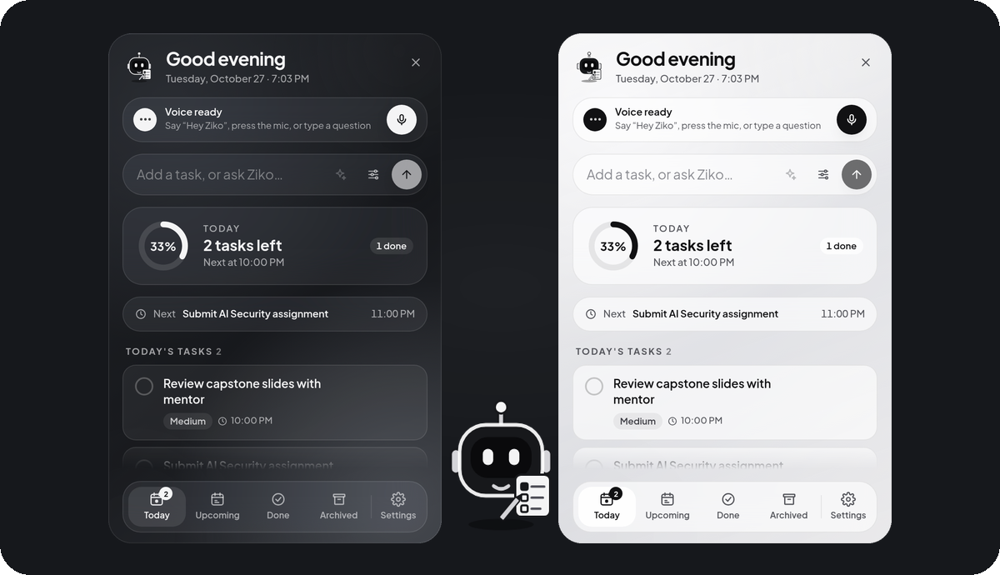
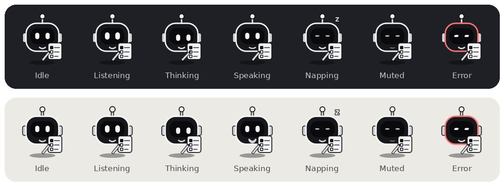
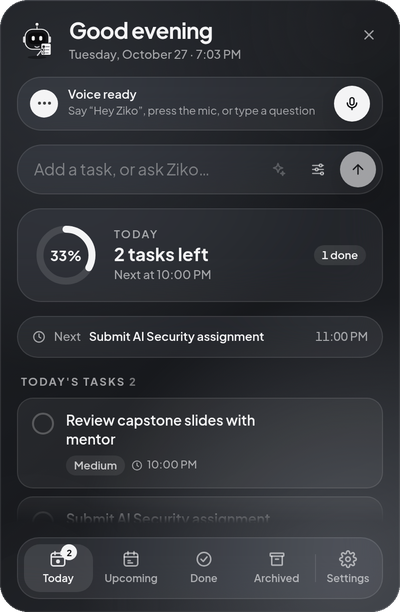
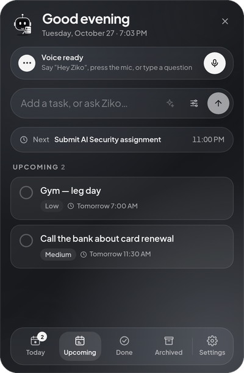
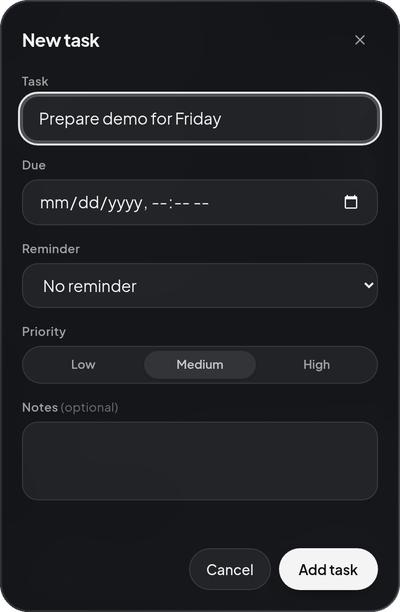
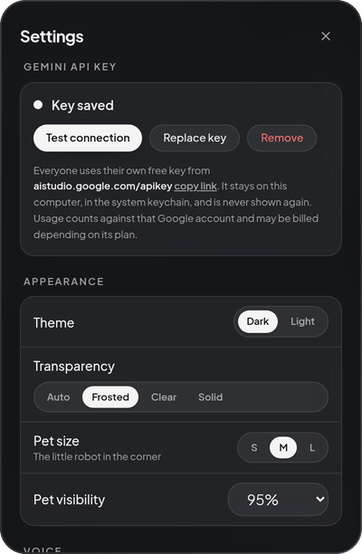
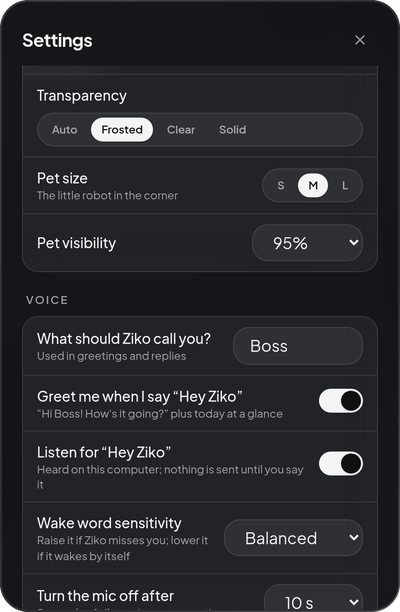
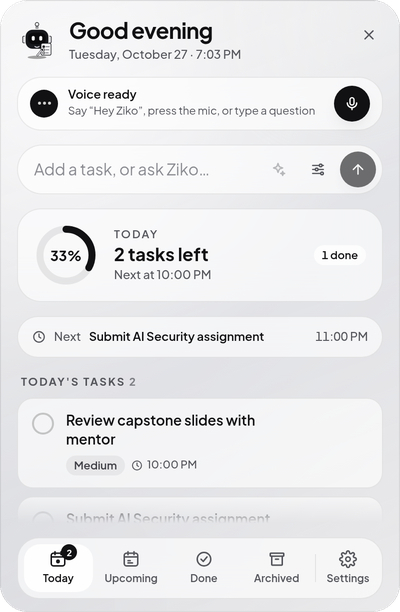
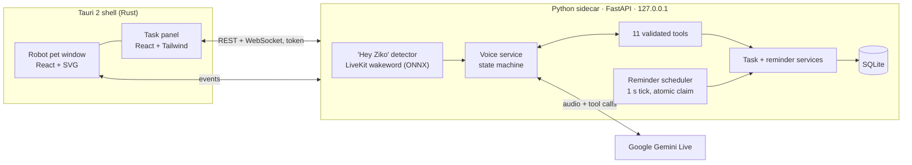

<div align="center">



# Ziko — AI Voice To-Do Assistant for Your Desktop

**Say "Hey Ziko", tell it what to do, and it's on your list.**
A tiny robot pet that lives in the corner of your screen, manages your tasks and reminders by voice
(Google Gemini Live) or by hand, and keeps everything on your own computer.

[](https://github.com/itsMeJunaid/ziko-ai-voice-todo/releases/latest)
&nbsp;
[-555555?style=for-the-badge&logo=windows&logoColor=white)](https://github.com/itsMeJunaid/ziko-ai-voice-todo/releases/latest)
&nbsp;
[](#-user-manual-linux)


[](LICENSE)



</div>

---

## ✨ What it does

| | |
|---|---|
| 🎙️ **Talk to your to-do list** | "Add a task to finish my report tomorrow at 10 AM and remind me 30 minutes before." Ziko understands, saves it, and confirms the day and time out loud. |
| 👋 **Greets you like a buddy** | Say **"Hey Ziko"** → *"Hey Boss! How's your day going? You've got one overdue task, and your AI assignment is due tonight."* Asks for a joke? It tells one — and laughs. |
| 🤖 **A pet, not a window** | A 44 px monochrome robot in the corner. Its eyes follow your mouse, it blinks, doodles in its notebook, naps when ignored, listens, thinks and talks. |
| 🔔 **Reminders that just work** | Desktop notifications even with the panel closed; snooze / dismiss; missed reminders after sleep or shutdown are shown once, never twice. |
| 🔒 **Private by default** | Tasks live in a local SQLite database. "Hey Ziko" is detected **on your computer**; audio goes to Gemini only during a conversation you start. |
| ⌨️ **Works without AI too** | Type, click, tick off. With no API key or no internet, everything except voice keeps working. |
| 🪶 **Light** | Idle: ~0.9% of a 20-core CPU with "Hey Ziko" listening, ~0.25% without it. Mic closes by itself after 10 s of silence. |

<div align="center">

</div>

## 📸 Screenshots

| Today | Upcoming | Add a task | Settings | Voice settings |
|:---:|:---:|:---:|:---:|:---:|
|  |  |  |  |  |

Light theme: 

---

## 📖 User manual (Linux)

Tested on **Ubuntu 24.04 with GNOME on Wayland**. Other Debian/Ubuntu-based distributions should work the same way; KDE and X11 sessions haven't been tested yet.

### 1. Install

1. Download **`Ziko_<version>_amd64.deb`** from the [latest release](https://github.com/itsMeJunaid/ziko-ai-voice-todo/releases/latest).
2. Install it (this also pulls in `libportaudio2` for the microphone if you don't have it):
   ```bash
   sudo apt install ./Ziko_*_amd64.deb
   ```
3. Open **Ziko** from your app menu (press <kbd>Super</kbd>, type *Ziko*) — or run `ziko` in a terminal.

The robot appears in the bottom-right corner. **Updating** later is the same command with the newer file; your tasks and settings are kept.

### 2. Turn on voice (optional, ~1 minute)

Ziko uses Google's Gemini Live for speech. Each person uses **their own free key**:

1. Get a key at **[aistudio.google.com/apikey](https://aistudio.google.com/apikey)** (sign in with Google → *Create API key* → copy it).
2. Click the robot → the voice bar says **Voice is off** → **Add key**.
3. Paste the key → **Save & test**. Ziko checks it with Google *before* saving; you'll see **Connected**.

The key is stored in your system keychain (GNOME Keyring / KWallet), never in a file and never shown again.
Gemini usage counts against that Google account and may be billed depending on its plan.

### 3. Everyday use

| To… | Do this |
|---|---|
| Open / close the panel | Click the robot · <kbd>Ctrl</kbd>+<kbd>Shift</kbd>+<kbd>Z</kbd> from any app · tray icon · <kbd>Esc</kbd> closes |
| Talk to Ziko | Say **"Hey Ziko"** · or press the 🎙️ mic in the panel · or double-click the robot |
| Type to Ziko | Write in the top box and press **✦ Ask Ziko** (pressing <kbd>Enter</kbd> adds the text as a task directly) |
| Add a task by hand | Type it and press <kbd>Enter</kbd>, or press the sliders button for date, reminder and priority |
| Finish / remove a task | Tick the circle · hover → archive (restore it later from **Archived**) |
| Answer a reminder | **Snooze** or **Dismiss** on the reminder card; the robot shows a red count until you do |
| Move the robot | Drag it anywhere (remembered) · right-click → *Reset dot position* |
| Mute the microphone | Tray → *Mute microphone*, or right-click the robot |
| Quit | Tray → *Quit Ziko* (or right-click the robot → *Quit Ziko*) |

**Things you can say**

> "Hey Ziko" *(it greets you with today's plan)* ·
> "Add *call the bank* tomorrow at 11 and remind me an hour before" ·
> "What's on today?" · "What should I work on next?" ·
> "Move the report to Friday at 4 PM" · "Mark *call mom* as done" ·
> "Delete the old meeting" *(Ziko asks you to confirm)* ·
> "Tell me a joke"

Good to know:
- A day without a time ("on Friday") means **by the end of that day**. Vague times ("later") get a follow-up question.
- If two tasks match ("call mom" vs "call mom about the trip"), Ziko asks which one — it never guesses.
- Ziko only says something is done **after** it's saved.
- While Ziko is speaking it ignores its own voice; just talk over it to interrupt.
- The panel shows a red **Mic on** chip whenever audio is going to Gemini. The mic closes after **10 s** of silence.

### 4. Settings

Click the robot → **Settings** (bottom right). Everything saves instantly.

| Section | What you can change |
|---|---|
| **Gemini API key** | Status, *Test connection*, *Replace key*, *Remove* |
| **Appearance** | Dark / Light theme · transparency (Auto, Frosted, Clear, Solid) · robot size and visibility |
| **Voice** | What Ziko calls you (default *Boss*) · greeting on "Hey Ziko" · wake word on/off and sensitivity · mic auto-off (5–30 s) · spoken replies · Ziko's voice · microphone |
| **Tasks** | Default priority · default reminder offset · snooze length · timezone |
| **General** | Start Ziko when you log in · open the panel at start |
| **Privacy & data** | What stays local · delete all tasks (type `DELETE`) · reset settings |

**Start automatically:** Settings → General → **Start Ziko when I log in**. Ziko then starts quietly (just the robot) every time you log in.

### 5. Troubleshooting

| Problem | Fix |
|---|---|
| "Hey Ziko" doesn't react | Settings → Voice → sensitivity **Sensitive**; check the right **Microphone** is selected; make sure the mic isn't muted (tray). |
| It wakes up by itself | Sensitivity **Strict**, or turn the wake word off and use the mic button. |
| *Gemini rejected the API key* | Settings → *Replace key* with a fresh key from AI Studio. |
| *Can't reach Gemini* | Check your internet; tasks and reminders keep working offline. |
| No desktop notifications | Make sure GNOME *Do Not Disturb* is off. |
| <kbd>Ctrl</kbd>+<kbd>Shift</kbd>+<kbd>Z</kbd> redoes instead | On GNOME Ziko adds this as a system shortcut; change it in *Settings → Keyboard → Custom Shortcuts*. |
| The robot is gone | It may be behind a full-screen app — press <kbd>Ctrl</kbd>+<kbd>Shift</kbd>+<kbd>Z</kbd>, or start Ziko again from the app menu. |

Logs live in `~/.local/share/Ziko/logs/` (task titles are left out unless you set `ZIKO_DEBUG_CONTENT=1`).

### 6. Uninstall

```bash
sudo apt remove ziko                                   # the app
rm -rf ~/.local/share/Ziko ~/.local/share/com.ziko.desktop   # optional: your tasks and settings
rm -f ~/.config/autostart/Ziko.desktop                 # optional: start-at-login entry
```
The API key can be removed first in Settings → *Remove*, or later in *Passwords and Keys* (entry `ziko-desktop`).
On GNOME, also delete the **Ziko: open panel** shortcut in *Settings → Keyboard → Custom Shortcuts*.

---

## 🔒 Privacy

- **Local first:** tasks, reminders and settings are stored only in `~/.local/share/Ziko/ziko.db`.
- **Wake word on device:** "Hey Ziko" runs on a small ONNX model on your CPU; nothing leaves the computer while idle.
- **Gemini only when you ask:** audio and typed requests go to the Gemini API during a conversation you start. Ziko doesn't record audio or save conversations. Google's retention depends on your key's plan — see the [Gemini API terms](https://ai.google.dev/gemini-api/terms).
- **Locked-down backend:** it listens on `127.0.0.1` only, needs a random per-launch token for every request, and the API key is never returned or logged (covered by tests).

## 📊 Resource use

Measured on the release build (Ubuntu 24.04, 20-core Intel Raptor Lake):

| State | CPU (share of one core) | Memory |
|---|---|---|
| Idle, listening for "Hey Ziko" | ≈ 17% (wake word ≈ 7–13%, UI ≈ 4%) — **≈ 0.9% of the whole CPU** | ≈ 830 MB total |
| Idle, wake word off | ≈ 5% | same |
| In a conversation | ≈ 28% | same |

Installed size: 94 MB. Network: none while idle; ~32 KB/s up / ~48 KB/s down during a conversation.

## 🧠 How it works



- **Tools, not free-form actions:** the model can only call 11 explicit tools (create / list / update / complete / archive tasks, reminders, daily summary, current time). Each is validated and runs in its own database transaction; the model hears the result only **after** it's committed.
- **Reliable reminders:** a database-polled scheduler claims due reminders atomically, so each fires once — even across restarts, sleep, or two scheduler instances.
- **Calm UI:** the robot is still between short moves, so an idle desktop costs almost nothing.

## 🛠️ Build from source

```bash
git clone https://github.com/itsMeJunaid/ziko-ai-voice-todo.git && cd ziko-ai-voice-todo
cd backend && uv sync && cd ../apps/desktop && pnpm install
pnpm tauri dev                       # run in development
```

Linux build prerequisites, the backend API, tests (pytest, vitest, Playwright), packaging (PyInstaller sidecar + `.deb` / Windows NSIS via GitHub Actions) and wake-word training are in **[docs/DEVELOPMENT.md](docs/DEVELOPMENT.md)**.

| Area | Stack |
|---|---|
| Desktop shell | Tauri 2 (Rust), WebKitGTK on Linux, WebView2 on Windows |
| UI | React 19, TypeScript, Tailwind CSS 4, Framer Motion, Zustand |
| Backend | Python 3.12, FastAPI, SQLAlchemy 2, Alembic, SQLite |
| Voice | Google Gemini Live (`gemini-3.8-live`), sounddevice / PortAudio |
| Wake word | LiveKit wakeword — custom-trained "Hey Ziko" ONNX model |
| Tests | 97 backend (pytest) · 29 frontend (vitest) · Playwright UI flows |

## 🗺️ Roadmap

- Signed Windows installer from CI (workflow in `.github/workflows/build.yml`)
- Calendar sync, recurring tasks, more languages (Urdu)
- AppImage / Flatpak for non-Debian Linux

## 📄 License

**Free and open source** under the [MIT License](LICENSE): use it, change it, share it, even commercially — just keep the
copyright notice. The "Hey Ziko" wake-word model was trained for this project and is included under the same license.
Google Gemini is a separate service with its own [terms](https://ai.google.dev/gemini-api/terms).

---

<div align="center">

Made by **[Junaid](https://github.com/itsMeJunaid)** · If Ziko helps you get things done, a ⭐ helps others find it.

</div>
